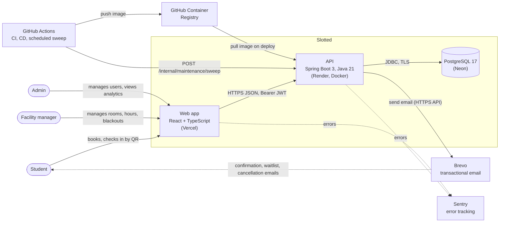
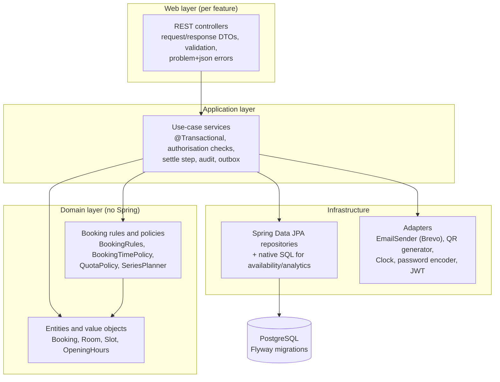
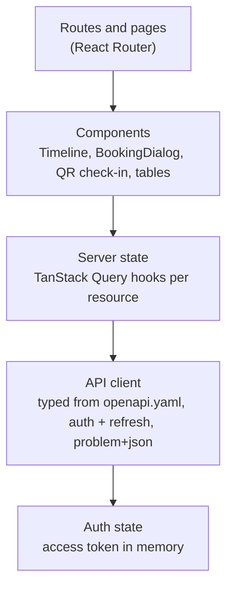
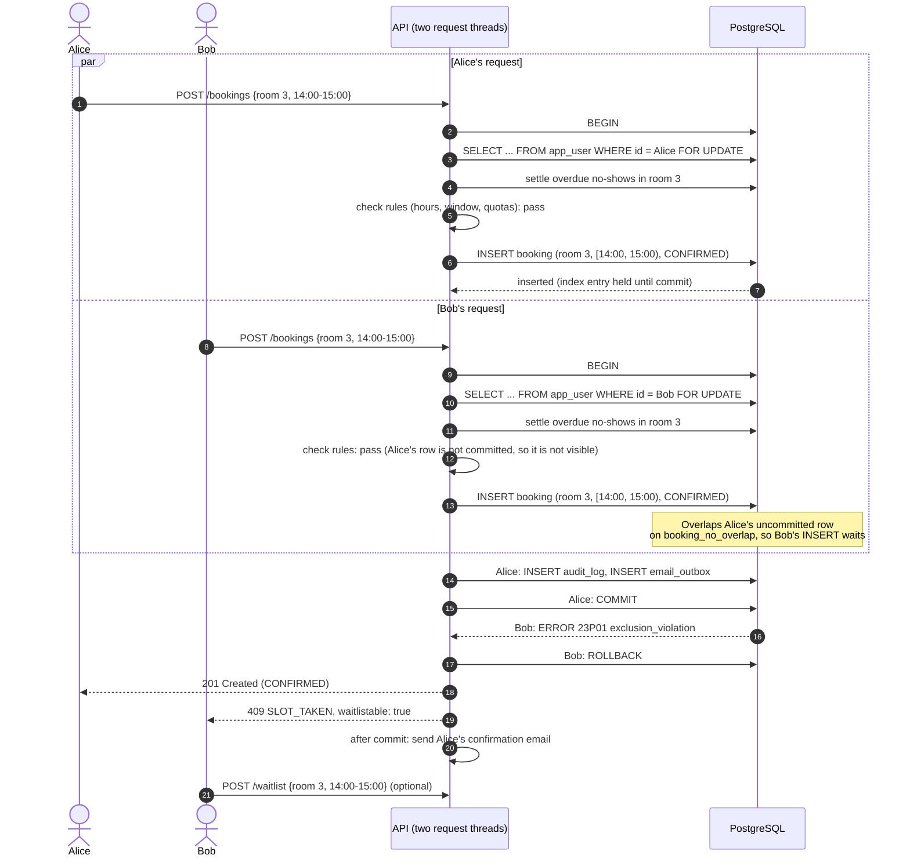
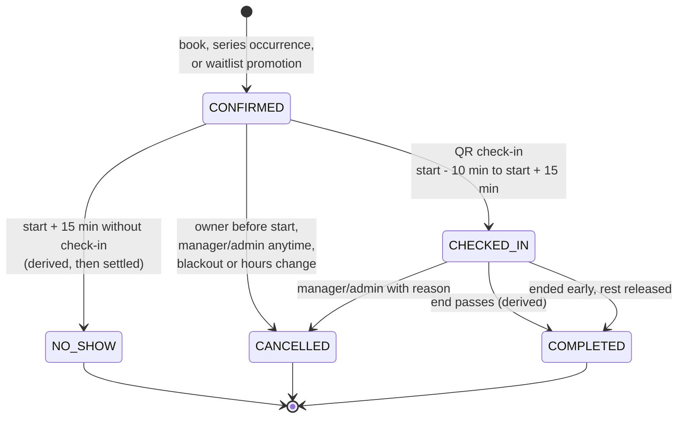
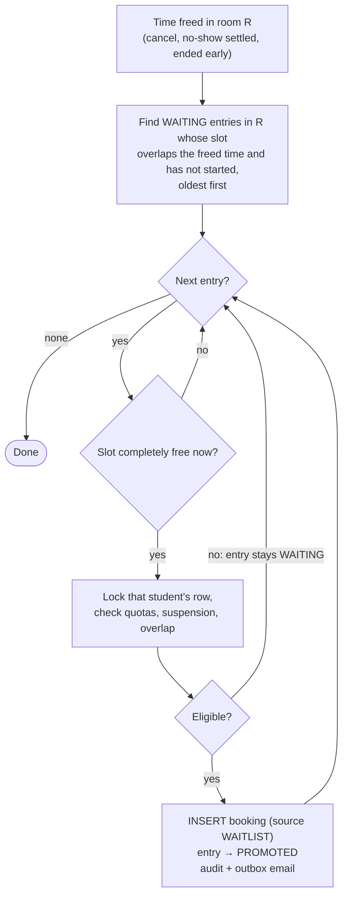
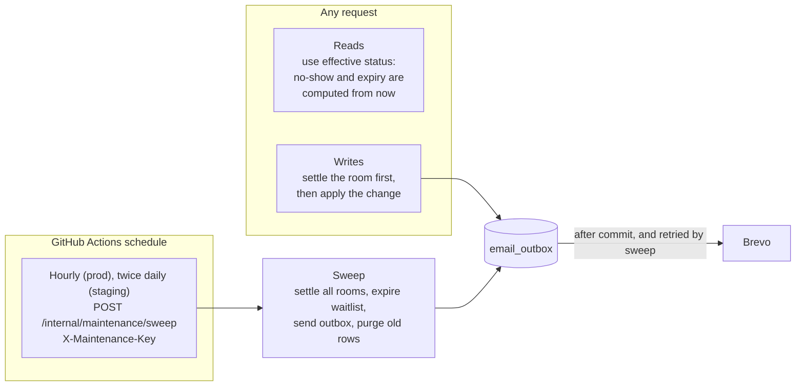
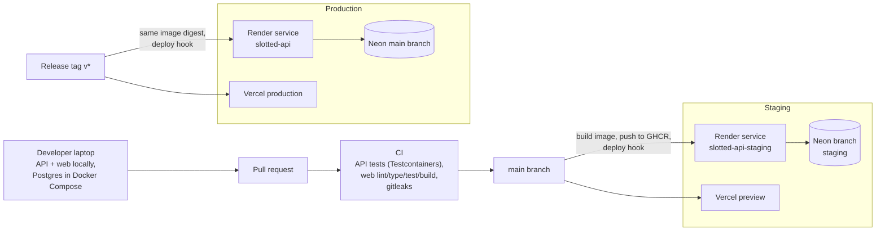

# Architecture

How Slotted is put together, and why. The reasoning behind the main choices is in the [ADRs](adr/README.md); the data model is in [ERD.md](ERD.md) and the API contract in [api/openapi.yaml](api/openapi.yaml).

## 1. Overview

Slotted is a single Spring Boot API (a modular monolith) backed by one PostgreSQL database, with a React single-page app as the only client. Everything runs on free tiers ([COSTS.md](COSTS.md)), which shapes three decisions:

1. **The database guarantees correctness.** Double bookings are prevented by an exclusion constraint, not by application locks or a cache ([ADR-0001](adr/0001-double-booking-prevention.md)).
2. **Nothing depends on the server being awake.** Time-based rules are evaluated when data is read or written; a scheduled GitHub Actions job only tidies up ([ADR-0004](adr/0004-lazy-evaluation-of-time-based-rules.md)).
3. **No extra infrastructure.** No message broker, no Redis, no separate worker. The email queue is a table (outbox) and the scheduler is GitHub Actions.

## 2. System context



| Element | Responsibility |
| --- | --- |
| Web app | All user interfaces. Static build served from Vercel's CDN. Holds the access token in memory and calls the API directly. Shows a "waking the server" state when the API is cold. |
| API | All business rules, authentication and authorisation, email outbox, audit log. Stateless: any instance can serve any request. |
| PostgreSQL | System of record. Enforces room overlap, foreign keys and value checks. |
| Brevo | Delivers emails queued in the outbox. Optional at runtime: bookings work if it is down. |
| GitHub Actions | CI on pull requests, CD on merge and tags, and the scheduled sweep. |

## 3. Layered architecture

### 3.1 API

The API is organised **by feature**, and each feature has the same layers inside it. Dependencies point inwards: web → application → domain, and infrastructure plugs into interfaces the application defines.



| Layer | Contains | Rules |
| --- | --- | --- |
| Web | `@RestController`s, DTOs, a global `@RestControllerAdvice` mapping exceptions to problem details | No business logic. DTOs are separate from entities, so the API shape does not leak table structure. |
| Application | One service per use case area (`BookingService`, `WaitlistService`, `CheckInService`, ...) | Owns transactions. Every write: lock student row → settle room → check rules → save → audit → outbox. |
| Domain | Rule classes and entities | Pure Java with an injected `Clock`, so rules are unit-tested without Spring or a database. |
| Infrastructure | Repositories, email, QR, security | Behind interfaces; tests swap them for fakes. |

Planned packages under `api/src/main/java/.../slotted/`:

```
auth/         sign-in, tokens, password policy, security config
user/         users, roles, suspension
facility/     facilities, opening hours, managers, blackouts
room/         rooms, check-in tokens and QR codes
booking/      bookings, availability, settle step, check-in, series
waitlist/     waitlist entries and promotion
audit/        audit log writer and queries
notification/ email outbox, templates, dispatcher, EmailSender
analytics/    utilisation queries
maintenance/  sweep endpoint
common/       errors, clock, time zone helpers, pagination
```

Module boundaries are checked with ArchUnit tests in Phase 1 (for example, `domain` must not depend on Spring or on `web`).

### 3.2 Web app



- Types for requests and responses are generated from [openapi.yaml](api/openapi.yaml), so the client and server share one contract.
- TanStack Query owns all server data: caching, refetch on focus, and invalidation after a booking, cancel or check-in. After `SLOT_TAKEN` the availability query is refetched so the timeline shows reality.
- The API client retries once after refreshing tokens on `401`, and shows a "waking the server" banner if the first request takes longer than a few seconds.
- All times are formatted in Asia/Singapore ([ADR-0003](adr/0003-timezone-handling.md)).

## 4. Two users book the same slot at the same time

Alice and Bob both see Study Room 3 free from 14:00 to 15:00 and press **Book** at the same moment. Each request runs in its own transaction on its own connection.



Points to notice:

- Both requests pass the application's rule checks; only the database sees both rows and can decide. This is why the check is a constraint and not application code ([ADR-0001](adr/0001-double-booking-prevention.md)).
- Bob waits only for Alice's short transaction, then fails fast. No retry loop is needed.
- If Alice's transaction had rolled back (for example, a quota failure after the insert), Bob's insert would have succeeded instead. Exactly one booking exists either way.
- The per-student `FOR UPDATE` lock does not make Alice and Bob wait for each other; it only stops one student's two tabs from beating the quota.
- Phase 2 proves this with an integration test: many threads book the same slot against a real Postgres (Testcontainers); exactly one gets `201`, the rest get `409`, and the table holds one active row.

## 5. Booking lifecycle

Stored statuses are `CONFIRMED`, `CHECKED_IN`, `CANCELLED` and `NO_SHOW`. `COMPLETED` is derived when an active booking's end has passed. Transitions marked *derived* are true at read time before they are written ([ADR-0004](adr/0004-lazy-evaluation-of-time-based-rules.md)).



Every transition writes an audit record. Transitions that free time (`CANCELLED`, `NO_SHOW`, ended early) run waitlist promotion in the same transaction.

## 6. Waitlist promotion



This runs inside the transaction that freed the time, so a promoted booking and the cancellation commit together or not at all. The exclusion constraint still applies to promoted bookings, so promotion can never create an overlap even if two cancellations race.

## 7. Time-based rules and the scheduled sweep



If the sweep is late or never runs, every answer the API gives is still correct; only no-show emails and database bookkeeping wait. Full reasoning and the failure table are in [ADR-0004](adr/0004-lazy-evaluation-of-time-based-rules.md).

## 8. Environments and delivery



- The same Docker image (by digest) is promoted from staging to production; it is never rebuilt for production.
- Flyway runs migrations on startup, before the app accepts traffic. Migrations are written to be backward compatible with the previous release so a rollback of the app does not need a database rollback.
- Health: Spring Boot Actuator `/actuator/health` (liveness and readiness), used by Render's health check.
- Swagger UI is enabled on staging only.
- Details, secrets and rollback steps come in `docs/DEPLOYMENT.md` (Phase 4).

## 9. Cross-cutting concerns

| Concern | Approach |
| --- | --- |
| Authentication | Short-lived JWT access tokens, rotating hashed refresh tokens ([ADR-0002](adr/0002-authentication-approach.md)) |
| Authorisation | Role rules in the security filter chain, `@PreAuthorize` with a facility-scope bean, ownership checks in services; authorisation tests per endpoint in Phase 5 |
| Validation | Bean Validation on DTOs for shape; domain rule classes for business rules, each with its own error code ([errors.md](api/errors.md)) |
| Errors | One `@RestControllerAdvice` producing RFC 9457 problem details with `code` and `requestId` |
| Time | `timestamptz` and `Instant` everywhere, rules in Asia/Singapore via injected `Clock` ([ADR-0003](adr/0003-timezone-handling.md)) |
| Concurrency | Exclusion constraint for rooms, per-student row lock for quotas, optimistic `version` for admin edits |
| Audit | Written by services in the same transaction as the change |
| Email | Transactional outbox, dispatched after commit and retried by the sweep |
| Logging | JSON logs with `requestId`, user ID and route; no personal data beyond IDs |
| Monitoring | Sentry for API and web errors (expected 4xx not reported), Actuator health |
| Memory | JVM sized for 512 MB: small heap, Serial GC, small Tomcat and Hikari pools, lazy initialisation where safe (Phase 4) |
| Database connections | Hikari pool with no idle connections, so Neon can scale to zero ([COSTS.md](COSTS.md)) |

## 10. Repository layout (from Phase 1)

```
api/                Spring Boot application (Maven)
web/                React + TypeScript (Vite)
docs/               PRD, architecture, ERD, ADRs, API contract, costs
.github/workflows/  CI, CD and the scheduled sweep
docker-compose.yml  Local Postgres
```
