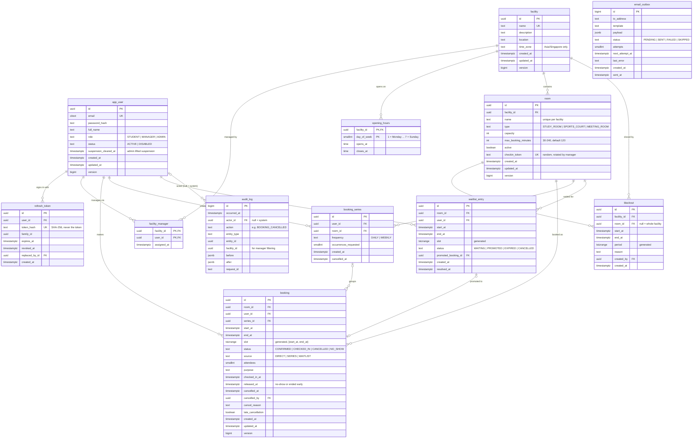

# Data model

PostgreSQL 17 (the same major version locally, in Testcontainers and on Neon). Schema changes are Flyway migrations in `api/src/main/resources/db/migration`. This page is the design; the migrations are the source of truth once they exist.

Conventions:

- Table names are singular (`booking`). `user` is a reserved word, so users live in `app_user`.
- Primary keys are `uuid` (`gen_random_uuid()`), except append-only logs, which use `bigint` identity.
- Every point in time is `timestamptz` ([ADR-0003](adr/0003-timezone-handling.md)). Wall-clock values (opening hours) are `time`.
- Enumerations are `text` with a `CHECK` constraint, so adding a value is a simple migration.
- Mutable rows have `created_at`, `updated_at` and a `version` column for optimistic locking in JPA.

## Diagram



## Tables

| Table | Purpose |
| --- | --- |
| `app_user` | Accounts and roles. `suspension_cleared_at` lets an admin lift a no-show suspension: only no-shows after it count ([ADR-0004](adr/0004-lazy-evaluation-of-time-based-rules.md)). Suspension itself is derived, not stored. |
| `refresh_token` | Hashed refresh tokens with rotation chain (`replaced_by_id`) and family for reuse detection ([ADR-0002](adr/0002-authentication-approach.md)). |
| `facility` | A venue with its own time zone and opening hours. |
| `facility_manager` | Which managers manage which facilities (many-to-many). |
| `opening_hours` | One open period per weekday. No row for a day means closed. `closes_at > opens_at`, so a facility cannot be open past midnight (BR-4). |
| `room` | Bookable space. `checkin_token` is the secret in the room's QR code. It is a low-value secret (it only proves presence at a room), so it is stored as is in order to reprint the QR code. |
| `blackout` | Unbookable period for a room or a whole facility. |
| `booking_series` | Groups the occurrences of a recurring booking. Each occurrence is a normal `booking` row, so every booking rule and the exclusion constraint apply to occurrences too. |
| `booking` | One booking. Stored `status` is what was last written; effective status (no-show, finished) is derived at read time ([ADR-0004](adr/0004-lazy-evaluation-of-time-based-rules.md)). Ending a checked-in booking early (BR-15) moves `end_at` to the next 30-minute boundary and sets `released_at`, so the freed time stops being covered by the exclusion constraint; the original end time stays in the audit log. |
| `waitlist_entry` | A student waiting for an exact slot. Queue order is `created_at`, then `id`. |
| `audit_log` | Append-only history of every change (BR-32). |
| `email_outbox` | Emails written in the same transaction as the change, sent and retried by the dispatcher. |

Utilisation analytics (AD-4) are computed from `booking`, `opening_hours` and `blackout` by query; there is no separate analytics table at this scale.

## Key constraints

```sql
CREATE EXTENSION IF NOT EXISTS btree_gist;
CREATE EXTENSION IF NOT EXISTS citext;

-- booking: one active booking per room per moment (ADR-0001)
CREATE TABLE booking (
    id                uuid PRIMARY KEY DEFAULT gen_random_uuid(),
    room_id           uuid NOT NULL REFERENCES room (id),
    user_id           uuid NOT NULL REFERENCES app_user (id),
    series_id         uuid REFERENCES booking_series (id),
    start_at          timestamptz NOT NULL,
    end_at            timestamptz NOT NULL,
    slot              tstzrange GENERATED ALWAYS AS (tstzrange(start_at, end_at, '[)')) STORED,
    status            text NOT NULL DEFAULT 'CONFIRMED'
                      CHECK (status IN ('CONFIRMED', 'CHECKED_IN', 'CANCELLED', 'NO_SHOW')),
    source            text NOT NULL DEFAULT 'DIRECT'
                      CHECK (source IN ('DIRECT', 'SERIES', 'WAITLIST')),
    attendees         smallint NOT NULL CHECK (attendees >= 1),
    purpose           text CHECK (char_length(purpose) <= 200),
    checked_in_at     timestamptz,
    released_at       timestamptz,
    cancelled_at      timestamptz,
    cancelled_by      uuid REFERENCES app_user (id),
    cancel_reason     text CHECK (char_length(cancel_reason) <= 500),
    late_cancellation boolean NOT NULL DEFAULT false,
    created_at        timestamptz NOT NULL DEFAULT now(),
    updated_at        timestamptz NOT NULL DEFAULT now(),
    version           bigint NOT NULL DEFAULT 0,

    CONSTRAINT booking_valid_range CHECK (start_at < end_at),
    -- a checked-in booking has a check-in time; only checked-in or later-cancelled bookings have one
    CONSTRAINT booking_checked_in_consistent
        CHECK (status <> 'CHECKED_IN' OR checked_in_at IS NOT NULL),
    CONSTRAINT booking_checked_in_status
        CHECK (checked_in_at IS NULL OR status IN ('CHECKED_IN', 'CANCELLED')),
    CONSTRAINT booking_cancelled_consistent
        CHECK ((status = 'CANCELLED') = (cancelled_at IS NOT NULL)),
    CONSTRAINT booking_no_overlap
        EXCLUDE USING gist (room_id WITH =, slot WITH &&)
        WHERE (status IN ('CONFIRMED', 'CHECKED_IN'))
);

-- Settle step and availability (ADR-0004)
CREATE INDEX booking_room_status_start ON booking (room_id, status, start_at);
-- My bookings, quotas and the per-student overlap check (BR-8, BR-9)
CREATE INDEX booking_user_start ON booking (user_id, start_at);

-- One waiting entry per student per exact slot
CREATE UNIQUE INDEX waitlist_one_per_slot
    ON waitlist_entry (user_id, room_id, slot) WHERE status = 'WAITING';
CREATE INDEX waitlist_queue ON waitlist_entry (room_id, status, start_at, created_at);

-- Room names unique within a facility, case-insensitive
CREATE UNIQUE INDEX room_name_per_facility ON room (facility_id, lower(name));
-- Lets blackout reference (room_id, facility_id) so a room blackout cannot point at another facility's room
ALTER TABLE room ADD CONSTRAINT room_id_facility UNIQUE (id, facility_id);
ALTER TABLE blackout ADD CONSTRAINT blackout_room_in_facility
    FOREIGN KEY (room_id, facility_id) REFERENCES room (id, facility_id);

CREATE INDEX blackout_period ON blackout USING gist (facility_id, period);
CREATE INDEX audit_entity ON audit_log (entity_type, entity_id, occurred_at);
CREATE INDEX audit_facility_time ON audit_log (facility_id, occurred_at);
CREATE INDEX outbox_pending ON email_outbox (next_attempt_at) WHERE status = 'PENDING';
```

Other checks: `room.capacity BETWEEN 1 AND 500`, `room.max_booking_minutes BETWEEN 30 AND 240 AND max_booking_minutes % 30 = 0`, `opening_hours.day_of_week BETWEEN 1 AND 7`, `opening_hours.closes_at > opens_at`, `facility.time_zone = 'Asia/Singapore'`.

## Rules the database does not enforce

These span rows or depend on configuration, so the service layer enforces them under the per-student row lock from [ADR-0001](adr/0001-double-booking-prevention.md):

- 30-minute alignment, booking length and booking window (BR-1 to BR-3), since they depend on the facility's zone and config.
- Opening hours and blackouts (BR-4, BR-5).
- Student quotas and no overlapping bookings for one student across rooms (BR-8, BR-9).
- Attendees within room capacity (BR-7).

## Deletion policy

- Bookings, waitlist entries and audit records are never hard-deleted by users; cancelling changes status.
- Rooms and facilities with bookings are deactivated, not deleted.
- The maintenance job removes expired refresh tokens, sent outbox rows after 30 days and audit records after 180 days (BR-33).
